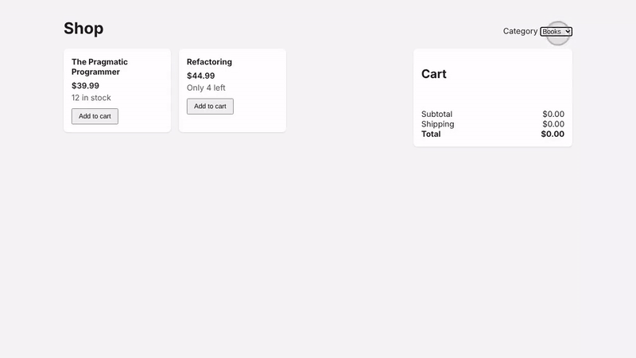

# Demo: a narrated video of what a task built

A video of a minute or three that walks what a task built, screen by screen, with a voice that
explains each step: for whoever reviews the PR, and for whoever asked for the change, with a
ticket or without one.

[](https://github.com/Akiles94/ai-dev-toolkit-examples/blob/main/examples/demo/storefront.mp4)

*A part of the [storefront demo](https://github.com/Akiles94/ai-dev-toolkit-examples/tree/main/examples/demo),
silent here. [The whole video](https://github.com/Akiles94/ai-dev-toolkit-examples/blob/main/examples/demo/storefront.mp4)
is 1 min 20 s with its voice, 1.1 MB.*

```bash
npx @akiles94/ai-dev-toolkit add demo
```

Set the command that starts your app in `.aidt/config.json` (`"demo": { "start": "npm start" }`),
then `/demo` in Claude Code, or the `demo` agent in Copilot. It runs only when you ask: no agent
hands off to it.

## Tokens for the script, none for the video

1. **Scope and cost.** The agent reads what the task built (the spec and plan if there are any,
   otherwise the branch and what you say to show) and how to run the product (`.aidt/app.md`,
   which it drafts the first time). It proposes the scenes, the length and a token estimate, and
   stops until you say «scope approved».
2. **The script.** It writes `.aidt/tasks/<task>/demo/<name>.json`: scenes of steps, and what the
   voice says. The script is committed with the task.
3. **The render.** `aidt demo render <script>` records it with no model: a real browser
   (Playwright), an offline voice (Piper), both mixed with ffmpeg. A circle marks each tap. The
   first time, the agent renders the first scene alone (`--sample`) to check the format. It
   starts the app with `demo.start` and stops it after, also on Ctrl+C.
4. **The PR.** The render writes the video, its subtitles and a PR text: what it shows, the commit
   it was rendered at, its length and the narration as a written walkthrough. Paste the text and
   drag the video into the PR description; GitHub has no API to attach one.

**A change asked in review:** fix the code and render again, with no tokens. When a label or a
step changed, the render stops at the step that broke, naming it, and only that step is fixed.

**The video is not committed:** it goes to `.aidt/demo/`, where the render puts a `.gitignore`.
The script is enough to make it again.

## The script

```json
{
  "title": "The storefront page",
  "app": { "url": "http://localhost:3000" },
  "device": "desktop",
  "scenes": [
    {
      "title": "Browse and fill the cart",
      "steps": [
        { "go": "/" },
        { "say": "Every product is a card with its price and how many are left." },
        { "select": { "label": "Category", "option": "Books" } },
        { "click": "Add to cart" },
        { "say": "Under fifty dollars, shipping is four ninety-nine." }
      ]
    }
  ]
}
```

| Step | What it does |
|---|---|
| `go` | Opens a path of `app.url` |
| `say` | The voice says the line; the video waits while it does |
| `click` | Taps the link or button with that text, or `{ "text", "nth" }`, or `{ "selector" }` |
| `fill` | Types into a field found by `label` or `selector` |
| `select` | Chooses an `option` in a dropdown found by `label` or `selector` (the browser's own option list is never recorded) |
| `press` | A key, such as `Enter` |
| `scroll` | Scrolls to a text further down |
| `wait` | Milliseconds |

`device` is `desktop` (1280 × 720) or `phone` (390 × 844 at twice the pixels). The command that
starts the app is never in the script: it is `demo.start` in `.aidt/config.json`, which the agent
cannot write, so a script cannot make a render run anything else. Without it, the app must already
be up at `app.url`.

## Voice and subtitles

`demo` in `.aidt/config.json`:

```json
"demo": {
  "voice": { "language": "es-419", "gender": "male" },
  "subtitles": "burned"
}
```

| `voice.language` | `female` | `male` |
|---|---|---|
| `en-US` (default) | `en_US-lessac-high` | `en_US-ryan-high` |
| `en-GB` | `en_GB-cori-high` | `en_GB-alan-medium` |
| `es-ES` (Spain) | `es_ES-sharvard-medium`, speaker F | `es_ES-davefx-medium` |
| `es-419` (Latin America) | `es_MX-claude-high` | `es_MX-ald-medium` |

Each one's pitch was measured on a sample sentence: the women's voices above 170 Hz, the men's
below 150 Hz. Any other [Piper voice](https://huggingface.co/rhasspy/piper-voices): `voice.model` (and
`voice.speaker` for voices with several people).

| `subtitles` | |
|---|---|
| `file` (default) | A `.vtt` next to the video; nothing drawn over the app |
| `burned` | Drawn into the picture, so they show wherever the video plays, a PR included |
| `none` | No subtitles |

Other keys: `start` (the command that starts the app), `output` (default `.aidt/demo`),
`voices` (where the voice models are, default `~/.cache/aidt/voices`), `piper` (the Piper
command).

## What it needs

Playwright with Chromium, ffmpeg, and Piper with the voice model. The toolkit installs and
downloads nothing: when something is missing, `aidt demo render` prints the commands, for example:

```text
Missing to render a demo. Run:
  pipx install piper-tts                      # or pip; or set demo.piper to its path
  mkdir -p "$HOME/.cache/aidt/voices"
  curl -L -o "$HOME/.cache/aidt/voices/en_US-lessac-high.onnx" https://huggingface.co/rhasspy/piper-voices/resolve/main/en/en_US/lessac/high/en_US-lessac-high.onnx
  curl -L -o "$HOME/.cache/aidt/voices/en_US-lessac-high.onnx.json" https://huggingface.co/rhasspy/piper-voices/resolve/main/en/en_US/lessac/high/en_US-lessac-high.onnx.json
```

A demo with nothing to say needs no voice. Playwright is found in the project or among npm's global
packages (`npm root -g`).

## Cost and model

On the [storefront example](https://github.com/Akiles94/ai-dev-toolkit-examples/tree/main/examples/demo),
a page built with the [full workflow](https://github.com/Akiles94/ai-dev-toolkit-examples/tree/main/examples/storefront):

| Step | Model | Turns | Agent time | Tokens in (cached) | Tokens out | Cost at API prices |
|---|---|---|---|---|---|---|
| Scope and cost | `claude-sonnet-5-5` | — | 15 s | 188k (169k) | 2k | $0.08 |
| Script, a sample and the video | `claude-sonnet-5-5` | 15 | 4 min 25 s | 498k (474k) | 6k | $0.20 |
| Rendering it again later (here, after the CLI's own review) | none | — | 1 min 50 s | 0 | 0 | $0.00 |

- The agent time includes its two renders (the sample and the video). A render takes a little
  longer than the video: the voice is made first, then the browser is recorded at normal speed.
  If the recorded video comes out shorter than the time recorded (its start lost, which would put
  the voice out of step), it is recorded once more, then the render fails saying so.
- Measured with Claude Code 2.1.327, headless (`claude -p`), on 2026-11-18. Most input tokens are
  cache reads, which cost a tenth of fresh input. With a Claude subscription the runs count toward
  usage limits instead.

## Limits

- Web apps and clickable designs. Terminal apps and native mobile apps are not recorded yet.
- The agent cannot see its own token usage; your tool's usage view does (`/cost` in Claude Code).
- A native dialog of the browser (a file picker, a print dialog, a dropdown's option list) is not
  recorded.
