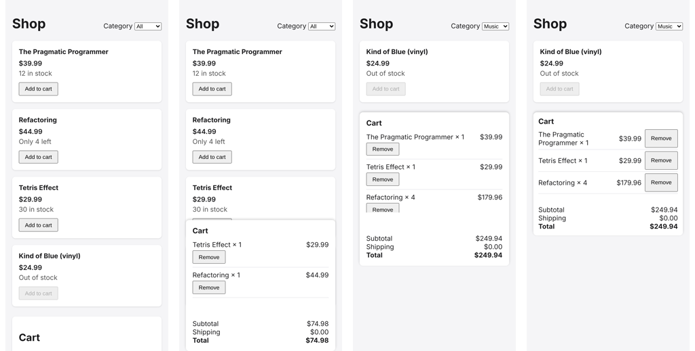

# QA: the product in use, as each person

The [reviewer](reviewer.md) reads a change's code against its plan. The QA **uses the product**,
as each person who will use it plus someone with bad intentions, and reports what they would trip
over: dead ends, bugs, contradictions, broken promises and blind spots. Green tests and a
reviewer's PASS prove nothing to it: they cover the paths someone already thought of.

```bash
npx @akiles94/ai-dev-toolkit add qa
```

Then `/qa block` in Claude Code, or the `qa` agent in Copilot, naming the branch. It runs only
when you ask: no agent hands off to it.

[](https://github.com/Akiles94/ai-dev-toolkit-examples/tree/main/examples/qa)

*On the [storefront example](https://github.com/Akiles94/ai-dev-toolkit-examples/tree/main/examples/qa),
a page the reviewer had passed: on a phone the cart was below every card (left); the fix docked it
(middle); the second pass found that, with three lines, the docked cart cuts a button in half
(right). Screenshots taken by `aidt qa walk`.*

[Why](#why-a-qa-and-not-only-a-reviewer) · [A pass](#a-pass) · [The walk](#the-walk) ·
[What you get](#what-you-get) · [The fixes](#the-fixes-and-their-tests) ·
[Before building](#before-building-the-plan-check) · [Cost](#cost-and-model) · [Limits](#limits)

## Why a QA, and not only a reviewer

A reviewer of the diff leaves three blind spots, and most of the serious problems of a growing
product hide in them:

- **The product is never used.** Nobody pressed back, reloaded, tapped twice or let the session
  expire.
- **Only the diff is read.** A block that adds a new kind of person (a family where there was one
  traveller) or a new state breaks older journeys its diff never shows.
- **Promises are not compared.** The landing page, the terms and the emails promise things the
  product may not do.

Run the reviewer first, then the QA, on a block that changes something a person uses (screens,
emails, texts, a design, a written process). A block with none keeps only the reviewer.

## A pass

1. **Scope and cost.** It reads what changed (the plan if there is one, the branch's files) and
   `.aidt/app.md`, the notes on how to run and use the product it shares with the
   [demo](demo.md) (it drafts them the first time). It proposes the journeys the change makes, the
   older journeys it touches (with the assumption each relied on), the promises about them, the
   people and states to try, about how many walks, and a token estimate. Nothing is walked until
   you say «scope approved».
2. **Walk.** One JSON file per journey and state, played by `aidt qa walk` in a real browser,
   with no model. It reads what the app answered at each step.
3. **Confirm.** Each finding's walk runs a second time; what does not show again goes under
   «Unconfirmed», never dropped.
4. **Verdict.** `FAIL` with a confirmed 🔴, or while a 🟡 is neither fixed nor written down as
   accepted by you: unowned 🟡 are how a hundred of them pile up. `PASS` otherwise, bound to the
   commit walked.
5. **Second pass**, after the fixes, in a fresh context with the first report: the findings'
   walks first (does each fix hold?), then what the first pass did not cover. A third needs your
   yes.

| Mode | Scope | When |
|---|---|---|
| `block` | the journeys a change makes and the ones it touches | after a block |
| `flow` | one whole flow, every person, every state | when a flow is complete |
| `audit` | every flow | before a first deployment or a launch |

## The walk

The agent writes the steps; the CLI plays them. No program of the agent's own runs on your machine
(it has no `node`, `curl` or install pre-approved): the only code it writes is the page
expressions of `keep`, which run inside the browser page. Running the same file again reproduces a
finding: it is how a developer sees it, and where its test starts.

**What a walk can reach.** `aidt qa walk` is pre-approved, so where it goes is not the agent's to
choose: by default this machine only (`localhost`, `127.0.0.1`, `[::1]`, any port). Its steps, the
page's own calls and WebSockets to anywhere else are blocked and logged as `blocked: outside
qa.origins`, so a walk cannot carry what it reads in your app anywhere. A walk against a staging
server, or a page that needs a CDN, lists those origins in `qa.origins` in `.aidt/config.json`,
which the agent cannot write: `["local", "https://cdn.example.com"]`, or only
`["https://staging.example.com"]`.

```json
{
  "title": "A double tap on Add to cart",
  "app": { "url": "http://localhost:3000" },
  "people": { "shopper": { "device": "desktop" }, "intruder": { "device": "phone" } },
  "steps": [
    { "go": "/" },
    { "click": "Add to cart", "times": 2 },
    { "look": "the cart after a double tap" },
    { "keep": { "cart": "localStorage.getItem('shop.cartId')" } },
    { "as": "intruder", "request": { "method": "DELETE", "path": "/carts/{cart}/items/p-1" } }
  ]
}
```

| Step | What it does |
|---|---|
| `go`, `click`, `fill`, `select`, `press`, `wait` | As in a [demo script](demo.md#the-script); `click` takes `"times": 2` for a double tap: quick clicks that do not wait for the button again, so one that disables itself takes only the first |
| `back`, `reload` | The browser's back button, a reload |
| `look` | A screenshot and the page's visible text |
| `keep` | A value from the page (an id, an address), from a page expression, reused as `{name}` in any text of a later step; an empty value stops the walk |
| `request` | A call to the app with the person's cookies: what a client that skips the page can do. Its status counts with the page's calls |
| `offline` | `true` makes every call of that person fail, their `request` steps included; `false` brings them back |
| `clear` | `cookies` or `storage`: an expired session, a cleared browser |
| `as` | Beside any step: who does that step; without it, the first person in `people`. Each person has a browser of their own (`phone` or `desktop`), and their first step on a page is a `go` |

```text
$ aidt qa walk .aidt/tasks/feat-SHOP-40-storefront/qa/walks/double-tap.json
Walk «A double tap on Add to cart» · http://localhost:3000 · at ebbe590
 1 shopper    go /
      GET / 200 · GET /products 200 · POST /carts 201 · GET /carts/cart-b3592575 200
 2 shopper    click "Add to cart" ×2
      POST /carts/cart-b3592575/items 200 · POST /carts/cart-b3592575/items 200
 3 shopper    look «the cart after a double tap»
      screenshot: .aidt/qa/double-tap/03-shopper.png
      │ Shop
      │ …
      │ Cart
      │ The Pragmatic Programmer × 2
      │ $79.98
      │ … 2 more line(s) in .aidt/qa/double-tap/03-shopper.txt
 4 shopper    keep cart
      cart = "cart-b3592575"
 5 intruder   request DELETE /carts/{cart}/items/p-1
      200 {"id":"cart-b3592575","items":[],"subtotalCents":0,"shippingCents":0,…}
Walked all 5 step(s).
Calls that failed or answered 4xx/5xx: 0 · console errors: 0 · page errors: 0
Log: .aidt/qa/double-tap/walk.json
```

For every step: the calls the page made with their status, console and page errors, calls that
failed. A call another person's page made meanwhile (a timer, a poll) is shown with their name;
one a page makes later than half a second after the step (a search that waits for typing to stop)
shows with the next step. A step that cannot be done stops the walk with a screenshot of what the screen showed
instead, and says why: nothing matched, or what it found and why it could not use it (disabled,
hidden, covered). The app must already be running, started as `.aidt/app.md` says: the walk starts
nothing. Screenshots and logs go to `.aidt/qa/` (`qa.output`), which git ignores; the walks are
committed with the report. Playwright comes from the project or npm's global packages; when it is
missing, the walk prints how to install it.

## What you get

`.aidt/tasks/<task>/qa/<mode>-<slug>.md`, from `templates/qa-report.md`: the journeys, people and
states covered, each finding with its walk file and step, what was seen against what was expected
(and which document says so), a proposed fix, what could not be confirmed, the official data
checked with its source, what was not covered, and the decisions for you.

| Kind | |
|---|---|
| Dead end | no way forward and none back, an error with no way to retry |
| Bug | wrong data or state, something another person can see or do, a server error |
| Contradiction | two screens, or a screen and an email, saying different things |
| Broken promise | a page, email or term promising what the product does not do |
| Confusing | a text that does not say what to do next, a layout broken on the device |
| Blind spot | a situation the product does not consider at all |

🔴 blocks or misleads a person, loses data or shows it to someone else · 🟡 a real annoyance or
risk · ℹ️ a note. Code style and structure stay the reviewer's.

## The fixes and their tests

The QA never fixes anything. The fixes go through the workflow like any block, and every
confirmed finding that is fixed leaves a test that reproduces its walk, written with the fix (end
to end when the project has a suite): the QA explores once and expensively, the suite guards
cheaply from then on.

## Before building: the plan check

`aidt add qa` also brings `.aidt/practices/plan-check.md`, the list a block's plan goes through
before any code: people, states, seams with older journeys, contradictions, official data,
business, promises, and what is left out on purpose. The planner goes through it only in projects
that have it. A gap found in the plan costs a line; found by the QA, it costs a fix block.

## Cost and model

On the [storefront example](https://github.com/Akiles94/ai-dev-toolkit-examples/tree/main/examples/qa),
a page built with the full workflow and passed by the reviewer:

| Step | Model | Turns | Agent time | Tokens in (cached) | Tokens out | Cost at API prices |
|---|---|---|---|---|---|---|
| Pass 1: scope and cost | `claude-sonnet-5-5` | — | 18 s | 114k (72k) | 2.4k | $0.14 |
| Pass 1: 9 walks, 15 runs, the report | `claude-sonnet-5-5` | 41 | 3 min 8 s | 1.75M (1.69M) | 17.6k | $0.59 |
| The fixes (SHOP-41): refiner, planner, builder, reviewer twice | `claude-sonnet-5-5` | — | 6 min 13 s | 4.0M (3.8M) | 53k | $1.47 |
| Pass 2: 4 walks, 7 runs, the report | `claude-sonnet-5-5` | — | 1 min 40 s | 773k (729k) | 7.7k | $0.26 |

- **The QA: $0.98 for two passes.** First pass: three 🟡 and a note on a page with 34 green tests
  and a reviewer's PASS. Second pass: the three fixed, and a new 🟡 the fix brought. The walks
  cost no tokens; each ran in 2 to 10 seconds.
- **About 200,000 tokens per walk**, as Claude Code counts them: most are the conversation read
  again from the cache, at a tenth of the price. The agent's estimate counts them that way.
- **The fixes are a block like any other.** On the same fix, the reviewer failed a CSS section from
  reading it; replaying the QA's walk showed it worked, and the reviewer withdrew the finding.
- **In Claude Code**, when the walk goes on in the conversation after the proposal, Claude Code
  asks before the first `aidt qa walk`: allow it for the session.
- Measured with Claude Code 2.1.327, headless (`claude -p`), on 2026-11-18. Most input tokens are
  cache reads, which cost a tenth of fresh input. With a Claude subscription the runs count toward
  usage limits instead.

## Limits

- Web apps, clickable designs and written processes. Slow calls, terminal apps and native mobile
  apps are not walked yet.
- It walks what runs locally: payments, email or AI services are only as real as the project's
  local fakes, which `.aidt/app.md` lists.
- The agent cannot see its own token usage; your tool's usage view does (`/cost` in Claude Code).
